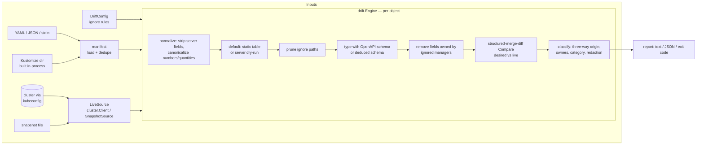

# driftlens

[](https://github.com/SlateGitOrg/driftlens/actions/workflows/ci.yml)

**Semantic drift detection between Git desired state and live Kubernetes objects.**

`kubectl diff` tells you *that* the cluster differs from your manifests. driftlens
tells you *what kind* of difference it is and *who caused it*: a pending Git change
the next sync will apply, a `kubectl scale` someone ran during an incident, an image
hot-patched with `kubectl set image`, a field both Git and a human changed (a
conflict), or a server default that is not a difference at all.

```
apps/v1 Deployment shop/worker  DRIFTED  image, manual-edit, spec  (basis: managed-fields, schema: openapi)
  ~ .spec.template.spec.containers[name="worker"].image  [image] live drift by kubectl-set (manual edit)
      desired:      ghcr.io/example/shop-worker:2.4.0
      live:         ghcr.io/example/shop-worker:2.3.1-hotfix
```

It is a Go library and CLI. It reads desired state from plain YAML/JSON, directories,
stdin (for example `kustomize build` output) or Kustomize directories built in-process,
and live state from a cluster (kubeconfig) or from an offline snapshot file.

## Why

GitOps pipelines make the cluster *eventually* match Git, but when it does not,
a plain diff lumps together five different situations: a pending Git change, a
manual `kubectl scale`, a hot-patched image, a conflict where Git and a human both
changed the same field, and a server default that is not a difference at all.
driftlens classifies each one so the report tells you what to do next.

## Who it is for

- Platform teams running Argo CD / Flux / `kubectl apply` pipelines who want drift
  reports that separate "Git moved" from "someone touched prod".
- CI jobs that should fail when a cluster was hand-edited, but not when it is merely
  behind Git (`--exit-code=drift`).
- Incident reviews: the field manager names in `managedFields` say which kubectl
  command or controller changed each field.

## What it does

| Capability | How |
|---|---|
| Normalizes defaults | A static defaulter for core workload/network/storage kinds, contract-tested against a real API server's dry-run output; optionally `--defaults=server` (dry-run create) for exact defaults incl. CRD schema defaults and mutating admission |
| Ignores server-managed fields | `status`, `uid`, `resourceVersion`, `managedFields`, bookkeeping annotations; server-assigned fields (Service `clusterIP`, `nodePort`, PVC `volumeName`, Job selectors, ...) unless Git pins them |
| Understands SSA ownership | Decodes `metadata.managedFields` (FieldsV1) with structured-merge-diff; attributes each difference to the field managers that own it |
| Three-way diff | last-applied (the `kubectl.kubernetes.io/last-applied-configuration` annotation, or SSA ownership) vs desired vs live, giving each change an origin: `git`, `live`, `conflict` or `unknown` |
| Schema-aware comparison | Built-in kinds use the OpenAPI schema compiled into client-go, so lists are compared by merge key (containers by `name`, ports by `containerPort`+`protocol`); CRDs fall back to a deduced schema |
| Ignore rules | JSON pointers (`/spec/replicas`, `*` wildcard), jq-like paths (`.spec.template.spec.containers[] \| select(.name == "app") \| .resources`, `[name=app]` shorthand), and field-manager globs (hide everything an HPA owns) |
| Classification | Per change: category `image` / `scale` / `metadata` / `spec`, origin, `manual` (owned by a kubectl-like manager), actors. Per object: `InSync`, `OutOfSync` (Git only), `Drifted`, `Missing`, `Error` |
| Output | Colored text, stable JSON (`apiVersion: driftlens/v1`), exit codes for pipelines |
| Safety | Read-only except the opt-in dry-run defaulter; Secret values are always redacted |

## Architecture



Package map (non-test Go; `git ls-files 'pkg/*.go' 'internal/*.go' | grep -v _test.go | xargs wc -l` = 4,683 lines, 4,928 including `cmd/`):

| Package | Role |
|---|---|
| `pkg/objpath` | Path model, JSON-pointer and jq-like pattern compiler, prune/find/relates |
| `pkg/manifest` | Decoding, list expansion, directory walk, in-process Kustomize, object refs |
| `pkg/normalize` | Server-field stripping, canonicalization, Secret `stringData` folding, static defaulter |
| `pkg/ownership` | managedFields decoding and owner lookup |
| `pkg/rules` | `DriftConfig` parsing/validation, manager classification |
| `pkg/drift` | Engine, typed comparison, three-way classifier, snapshot source, report model |
| `pkg/report` | Text and JSON renderers |
| `internal/cluster` | Dynamic client, RESTMapper, server dry-run defaulter, SSA/patch helpers |
| `internal/cli` | `diff`, `snapshot`, `rules`, `version` commands |
| `internal/scenario`, `internal/kubeenv` | Scenario runner and envtest wrapper shared by tests and the demo |

Deeper design, algorithms and complexity: [docs/ARCHITECTURE.md](docs/ARCHITECTURE.md).
Design decisions and trade-offs: [DECISIONS.md](DECISIONS.md).

## Quick start

Requirements: Go 1.27, and for the tests/demo the envtest binaries (kube-apiserver and
etcd, about 100 MB, downloaded once by `make envtest`).

```sh
make build                      # bin/driftlens
make check                      # fmt, vet, golangci-lint, race tests incl. envtest, coverage gate
make demo                       # end-to-end demo on a throwaway API server (no Docker, no cluster)

# Against your cluster (read-only):
bin/driftlens diff -k overlays/prod
kustomize build overlays/prod | bin/driftlens diff -f - -o json
bin/driftlens diff -f manifests/ --config driftlens.yaml --show-ignored --explain

# Offline: capture now, compare later or elsewhere
bin/driftlens snapshot -k overlays/prod --out live.yaml
bin/driftlens diff -k overlays/prod --live live.yaml
```

### CLI

```
driftlens diff     [-f PATH]... [-k DIR]... [--live FILE | --kubeconfig FILE] [flags]
  -f, --filename     manifest file or directory, or - for stdin (repeatable)
  -k, --kustomize    kustomization directory (repeatable)
  --live             snapshot file to compare against instead of a cluster
  --kubeconfig, --context, -n/--namespace (default "default")
  --config           DriftConfig file
  -o, --output       text | json
  --defaults         static (default) | server | none
  --exit-code        any (default) | drift | never
  --show-ignored, --show-in-sync, --explain, --color auto|always|never, -v
driftlens snapshot [-f PATH]... [-k DIR]... [--kubeconfig FILE] [--out FILE]
driftlens rules    [--config FILE]     # validate a config and print compiled patterns
driftlens version
```

Exit codes: `0` no drift, `1` drift found, `2` error. With `--exit-code=drift`, objects
that are only `OutOfSync` (Git ahead of the cluster) do not fail the run.

### Configuration

```yaml
apiVersion: driftlens/v1
kind: DriftConfig
gitopsManagers: [argocd-controller, kustomize-controller]   # globs; default list in pkg/rules
manualManagers: ["kubectl", "kubectl-*", "k9s"]             # globs; GitOps list wins
reportUnattributed: false     # report live-only fields nobody can be blamed for (usually defaults)
ignore:
  - name: hpa-owns-replicas
    match: {group: apps, kind: Deployment, namespace: "prod-*"}   # globs, empty = any
    managers: [kube-controller-manager]                          # hide fields this manager owns
  - name: sync-stamp
    paths: ["/metadata/annotations/example.com~1synced-at"]      # JSON pointer
  - name: vpa
    paths: ['.spec.template.spec.containers[] | select(.name == "app") | .resources']
```

Prefer `[name=app]` or `select()` over list indices. An index (`/containers/1/image`,
`.env[0]`) counts positions in the **desired** object; for keyed lists (containers, env,
ports, volumes, ...) driftlens then hides that element by its merge key on the live side,
so a reordered or inserted live element does not move the rule onto a different one. The
rest of the pattern after the index is matched on each side, so
`.containers[0].env[]` also hides an env var added live to that container. An index past
the end of the Git list selects nothing. Indices into atomic lists (`args`,
`command`, all CRD lists) are positional on each side. See
[ARCHITECTURE §6](docs/ARCHITECTURE.md#6-path-patterns).

## How a difference is explained

For each difference between normalized desired and live state, driftlens looks for
history in this order:

| Basis | When | Origin rules |
|---|---|---|
| `last-applied` | the live object has the client-side-apply annotation | desired = last-applied, live differs → **live**; live = last-applied, desired differs → **git**; all three differ → **conflict**; field in last-applied but not desired → **git** (pending prune) |
| `managed-fields` | server-side apply / managedFields present | a GitOps manager owns the live value → **git**; another manager owns it → **live** (and **manual** if that manager matches `manualManagers`); live-only field owned by a GitOps *Apply* → **git** (pending prune) |
| `none` | e.g. a snapshot without metadata | **unknown**; live-only fields are treated as defaults unless `reportUnattributed` |

Live-only fields that no non-GitOps manager owns are server defaults and are not reported
(`--show-ignored` lists them). Categories: `image` (`containers[*].image`, incl. init and
ephemeral containers), `scale` (`.spec.replicas` of scalable kinds, or anything written
through the `scale` subresource), `metadata`, and `spec` for everything else.

## Demo

`make demo` starts envtest, applies `examples/shop/overlays/prod` with server-side
apply as `argocd-controller`, simulates an incident (kubectl scale / set image / edit /
label, an HPA scaling through the scale subresource, a bot stamping an annotation),
then diffs against the *next* Git revision. Output of a real run (sections 1, 2, 4 and 6
omitted here):

```
== 3. Right after the sync: everything is in sync ==========================
$ driftlens diff -k examples/shop/overlays/prod --config examples/shop/driftlens.yaml

Summary: 6 objects, 6 in sync; 0 changes

== 5. Meanwhile Git moved on (overlays/next: worker 2.4.0, recommendations on)
driftlens separates what Git changed from what the cluster changed:
$ driftlens diff -k examples/shop/overlays/next --config examples/shop/driftlens.yaml --show-ignored
v1 ConfigMap shop/shop-settings  OUT OF SYNC  spec  (basis: managed-fields, schema: openapi)
  ~ .data.FEATURE_RECOMMENDATIONS  [spec] pending Git change
      desired:      "on"
      live:         "off"
apps/v1 Deployment shop/api  in sync
  = .spec.replicas  ignored by hpa-owns-api-replicas: owned by kube-controller-manager (scale)
  = .metadata.annotations["example.com/synced-at"]  ignored by sync-timestamp: path .metadata.annotations["example.com/synced-at"]
apps/v1 Deployment shop/web  DRIFTED  manual-edit, metadata, scale  (basis: managed-fields, schema: openapi)
  ~ .spec.replicas  [scale] live drift by kubectl-scale (scale) (manual edit)
      desired:      3
      live:         6
  - .metadata.labels.incident  [metadata] live drift by kubectl-label (manual edit)
      live:         INC-4211
apps/v1 Deployment shop/worker  DRIFTED  image, manual-edit, spec  (basis: managed-fields, schema: openapi)
  ~ .spec.template.spec.containers[name="worker"].args  [spec] live drift by kubectl-edit (manual edit)
      desired:
        - --queue=orders
        - --concurrency=4
      live:
        - --queue=orders
        - --concurrency=4
        - --debug
  ~ .spec.template.spec.containers[name="worker"].image  [image] live drift by kubectl-set (manual edit)
      desired:      ghcr.io/example/shop-worker:2.4.0
      live:         ghcr.io/example/shop-worker:2.3.1-hotfix

Summary: 6 objects, 3 in sync, 1 out of sync, 2 drifted; 5 changes (1 image, 1 metadata, 1 scale, 2 spec; 1 git, 4 live; 4 manual); 2 ignored
(exit 1: drift found)

== 7. Offline: snapshot the live objects, diff later without the cluster ===
$ driftlens snapshot -k examples/shop/overlays/next --out $DEMO_TMP/live.yaml
$ KUBECONFIG=/dev/null driftlens diff -k examples/shop/overlays/next --config examples/shop/driftlens.yaml -o json --live $DEMO_TMP/live.yaml
snapshot: 9640 bytes; offline JSON report identical to live report: true

== 8. Exit codes for pipelines =============================================
driftlens diff --exit-code=any   -> exit 1
driftlens diff --exit-code=drift -> exit 1
driftlens diff --exit-code=never -> exit 0
```

Note the worker image: Git moved to 2.4.0 *and* someone hot-patched 2.3.1-hotfix. Under
server-side apply only the live side is provable, so it is reported as live drift, not a
conflict (see Limitations).

## Tests, evaluation and benchmarks

All numbers below come from the commands shown, run on an Apple M1 Pro (8 cores) shared
with other build jobs.

**Gate** — `make check` (gofmt, `go vet`, golangci-lint with 15 linters and zero findings,
`go test -race` including envtest with `DRIFTLENS_REQUIRE_ENVTEST=1` so the API-server
tests cannot silently skip, then the coverage gate):

```
78 tests + 87 subtests passed, 0 failed, 1 skipped
core coverage: 96.3% (1895/1968 statements), threshold 80%
```

The skip is the server-defaults replay of the one client-side-apply scenario, which
cannot be created twice in the same API server.

**What the tests cover**

- *Golden scenarios* (`testdata/scenarios/*`, 9 scenarios): each is applied to a real API
  server (envtest), mutated by named field managers, and diffed. The same golden text and
  JSON must come out of the live run, of the offline replay of the captured `live.yaml`,
  and of the run with `--defaults=server`. `make fixtures` re-captures snapshots,
  `make golden` rewrites expectations.
- *Static defaulter contract* (`TestStaticDefaultsMatchServer`): 11 objects (Pod,
  Deployment, ReplicaSet, ReplicationController, PodTemplate, Job, LoadBalancer and
  ExternalName Services, PVC, NetworkPolicy, Secret) must compare in sync with the API
  server's dry-run output. Together with the `in-sync-defaults` scenario (9 objects) this
  is 20 objects whose only differences are API defaults, with 0 reported changes.
- *CLI end-to-end* against envtest through a kubeconfig file, stdin input, server
  defaults and snapshot replay; unit tests per package; `FuzzCompile` for the pattern
  parser (`make fuzz`).

**Mutation evaluation** — `make eval` (seed 2026, used during development) and
`make eval EVAL_SEED=7` (run once after development as a held-out check). Each of 120
trials applies a Deployment and a ConfigMap with server-side apply (60 trials) or
client-side apply (60), then performs a random subset of 14 Git and live edits whose
correct classification is known by construction, and scores the report. Results are in
`eval/results-seed-*.json`:

| Seed | Mode | Expected changes | Recall | Precision | Origin acc. | Category acc. | Manual acc. | Object status acc. |
|---|---|---|---|---|---|---|---|---|
| 2026 | SSA | 312 | 100% | 100% | 76.0% | 100% | 93.3% | 90.0% |
| 2026 | CSA | 317 | 100% | 100% | 100% | 100% | 93.4% | 100% |
| 7 | SSA | 312 | 100% | 100% | 79.8% | 100% | 93.3% | 95.8% |
| 7 | CSA | 300 | 100% | 100% | 100% | 100% | 93.3% | 100% |

Every miss is one of the documented limitations below (the test fails on any other miss):
under SSA, a field added in Git is `unknown` rather than `git`, and a field changed by both
Git and a person is `live` rather than `conflict`; in both modes a live *deletion* has no
owner, so `manual` cannot be set. This is a synthetic evaluation of the engine's logic
on the edits it was designed for. It does not measure accuracy on real clusters, and the
edit set was written by the same author as the engine.

**Benchmarks** — `make bench` (`go test ./pkg/drift -bench . -benchmem`):

| Benchmark | Time/op | Memory/op | Allocs/op |
|---|---|---|---|
| One drifted Deployment with real managedFields (4 changes) | 125 µs | 90.6 KB | 1,101 |
| Run over 100 such objects from a snapshot | 12.2 ms | 9.6 MB | 113.9k |
| Run over 1,000 such objects from a snapshot | 112 ms | 95.6 MB | 1.14M |

Live runs are dominated by API round trips (one GET per object, plus one dry-run create
per object with `--defaults=server`).

## Design decisions (short)

- **structured-merge-diff for comparison.** The same library and schema the API server
  uses for server-side apply, so list semantics (merge keys, atomic lists, sets) match
  what `kubectl apply --server-side` would do. Hand-rolled diffing gets ports and env
  wrong.
- **Ownership before heuristics.** Who owns a field is a fact recorded by the API server;
  driftlens prefers it over guessing from values. When there is no history it says
  `unknown` instead of guessing.
- **Static defaults verified by a contract test,** with a server dry-run mode for exact
  results. The static table keeps offline mode useful; the contract test stops it from
  quietly going stale.
- **Ignore rules prune before comparing** (Argo CD-style), so an ignored field inside an
  atomic list cannot leak a difference, and hidden differences are still listed with
  `--show-ignored`.
- **Secrets are redacted** in every output, including values that only differ.

All design decisions with their costs: [DECISIONS.md](DECISIONS.md).

## Limitations

- **SSA history is incomplete by design.** managedFields records who owns each present
  field, not past values or deletions. So with server-side apply alone: (1) a field
  present in Git but absent live is `unknown` (a Git addition and a live deletion look
  identical); (2) when Git and a person both changed a field, it is reported as `live`,
  not `conflict`; (3) deletions are never attributed to an actor. Client-side apply's
  last-applied annotation does not have problems (1) and (2).
- **List indices in ignore rules count in Git's order.** An index into a keyed list
  cannot name an element that exists only live (values below an element it does name,
  such as a live-added arg under `containers[0].args[]`, are hidden), and a rule written against an old Git
  order follows the element now at that position in Git. Use `[name=x]` selectors for
  rules that must survive reordering.
- **Static defaults cover core kinds only** (Pod templates, Deployment, StatefulSet,
  DaemonSet, ReplicaSet, RC, Job, CronJob, Service, PVC, Secret, NetworkPolicy). They are
  verified against Kubernetes 1.37 envtest only. HPA `behavior`, Ingress, RBAC and CRD
  schema defaults are not in the table. Use `--defaults=server` for those (it needs
  `create` permission, one request per object, and mutating webhooks change its result).
- **CRDs use a deduced schema:** every list is atomic, so changing one element of a CRD
  list reports the whole list. driftlens does not read CRD OpenAPI schemas from the
  cluster.
- **No orphan detection.** Objects that exist live but not in Git are not found (that
  needs a label/ownership convention such as Argo CD's tracking labels).
- **Live objects are fetched in the desired object's API version;** snapshots taken in
  another version are reported as errors, not converted.
- **Quantity canonicalization is path-based** (`requests`, `limits`, `hard`, `capacity`,
  `allocatable`, `sizeLimit`). Quantities stored elsewhere are compared as strings.
- **Envtest is not a cluster.** No controllers run, so the tests simulate kubectl and
  controllers with patch requests under their field-manager names. The manager names
  (`kubectl-scale`, `kubectl-set`, ...) follow kubectl's defaults. They were not captured
  from a real kubectl binary in the tests.
- No production deployments yet; treat the classification as a tool for reviewing drift,
  not as an enforcement mechanism.

## Roadmap

- Read CRD structural schemas from the cluster (`/openapi/v3`) instead of deducing.
- Orphan detection via Argo CD / Flux tracking labels or an inventory ConfigMap.
- Record per-revision applied values (an annotation written by a driftlens apply hook)
  to close the SSA add/conflict gaps.
- Parallel live fetches with a bounded worker pool. Watch mode with Prometheus metrics.
- Helm rendering as an input next to Kustomize.

## Development

```sh
make check          # the full gate (needs envtest binaries; `make envtest` downloads them once)
make fixtures       # re-capture testdata/scenarios/*/live.yaml from envtest
make golden         # rewrite expected.{txt,json} from the offline replay
make eval bench fuzz
```

## License

MIT — see [LICENSE](LICENSE).
