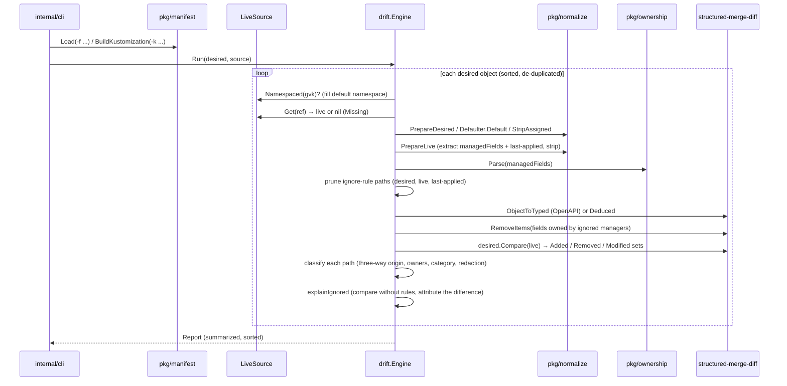
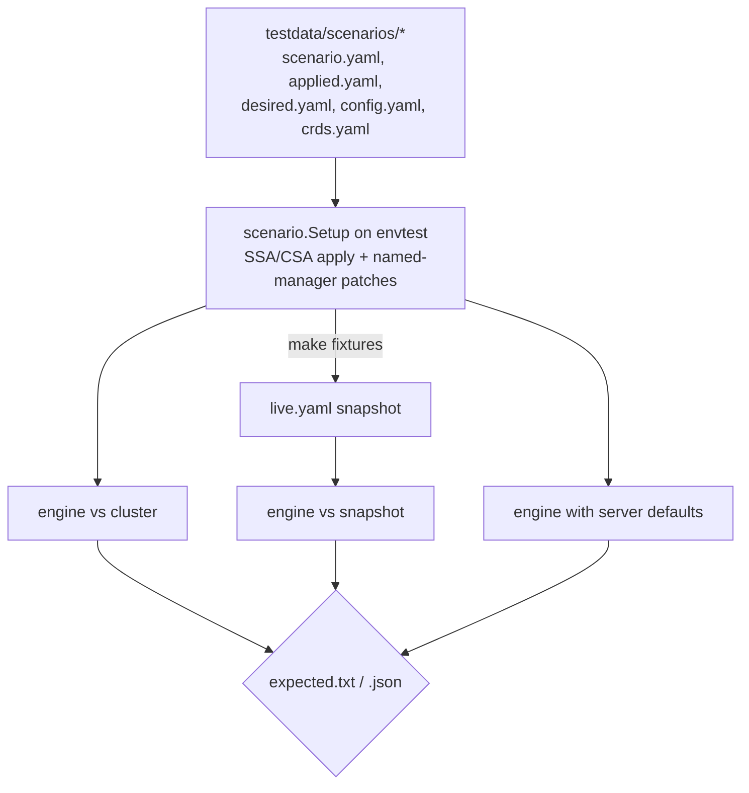

# driftlens architecture

This document describes how a desired object and a live object become a list of
explained changes, the algorithms involved, and their cost.

## 1. Data flow

## 2. Normalization

Normalization makes two semantically equal objects structurally equal. It runs on all
three sides (desired, live, last-applied) and never modifies its input.

1. **Server-managed fields** (`StripServerFields`): `status`, `metadata.{uid,
   resourceVersion, generation, creationTimestamp, deletionTimestamp,
   deletionGracePeriodSeconds, selfLink, managedFields}`, and bookkeeping annotations
   (`kubectl.kubernetes.io/last-applied-configuration`, `deployment.kubernetes.io/revision`).
2. **Server-assigned fields** (`StripAssigned`): per kind, a list of jq-like patterns
   (Service `clusterIP(s)`, `ipFamilies`, `ipFamilyPolicy`, `ports[].nodePort`; PVC
   `volumeName`, `storageClassName` and binding annotations; Job selector and
   controller-uid labels; Pod `nodeName`, `priority`, `tolerations`, ...; StatefulSet
   `volumeClaimTemplates[].status`; DaemonSet template-generation annotation; Namespace
   `spec`). Each is removed from live and last-applied **unless the desired object sets
   it**. If Git pins a `clusterIP`, it is still compared.
3. **Canonicalization** (`Canonicalize`): integral floats become `int64` (YAML `3.0`
   versus JSON `3`), `null` and empty lists are dropped, empty Go-map fields (`labels`,
   `annotations`, `data`, `nodeSelector`, `requests`, `limits`, nested `metadata`, ...)
   are dropped, and resource quantities under `requests`/`limits`/`hard`/`capacity`/
   `allocatable`/`sizeLimit` are rendered canonically (`1000m` → `1`, `1024Mi` → `1Gi`).
4. **Secret `stringData`** is base64-folded into `data` the way the API server does, so a
   Secret written with `stringData` compares equal to the stored object.
5. **Defaults** (`Defaulter`):
   - `Static`: a table that mirrors the Kubernetes defaulting functions for Pod specs
     (restart/DNS policy, scheduler, grace period, security context, container
     termination message, pull policy derived from the image tag, probe timings and
     schemes, port protocols, volume `defaultMode`, `fieldRef.apiVersion`, hostPath
     type), Deployment/StatefulSet/DaemonSet/ReplicaSet/RC strategies and history
     limits, Job/CronJob policies, Service type/affinity/traffic policies/targetPort,
     PVC volume mode, Secret type and NetworkPolicy policy types. It is idempotent
     (unit-tested) and **contract-tested against the API server**: the
     `TestStaticDefaultsMatchServer` envtest compares the statically defaulted object with
     a server dry-run create of the same object. Any default the table lacks shows up
     there as a live-only field owned by the dry-run manager, and the test fails.
   - `ServerDefaulter`: dry-run create of a renamed copy (`generateName`, so it works
     when the object already exists), name restored afterwards. Exact for every built-in
     default, CRD structural-schema defaults and mutating admission.
   - `NoDefaults`.

   After defaulting, server-managed and server-assigned fields are stripped again, so the
   dry-run's allocated `clusterIP` never appears as a difference.

## 3. Typed comparison

`applyconfigurations.NewTypeConverter(scheme.Scheme)` gives a structured-merge-diff
parser for every built-in kind client-go knows. Each normalized object becomes a
`typed.TypedValue`, and `desired.Compare(live)` returns three `fieldpath.Set`s:

- `Modified`: present on both sides with different values. These are leaves, or atomic
  values such as `args` lists.
- `Removed`: present in desired only → reported as op `add` (applying desired adds it).
- `Added`: present live only → reported as op `remove` (applying desired removes it).

List semantics come from the schema: `containers` is a map keyed by `name`, container
`ports` by `containerPort`+`protocol`, `finalizers` is a set, `args` is atomic. If any of
the three objects fails schema validation (an unknown field, or a kind newer than this
build), all three fall back to `typed.DeducedParseableType`: maps are granular, every list
is atomic. The report says `schema: deduced` and carries the validation error as a
warning. CRDs always use the deduced schema.

**Granularity.** Added/removed subtrees are reported where a person would look for them:
a list element (a container, an env var, a port) is reported as one change, and maps are
expanded to their members (each label, annotation or data key separately). The rule is in
`orderedPaths`: a member is skipped if an ancestor list element is also a member, or if it
is a map that has members below it.

## 4. Ownership

`metadata.managedFields[*].fieldsV1` is decoded into one `fieldpath.Set` per entry
(manager, operation, subresource). `Owners(p)` returns the entries that own `p`, a member
below `p`, or an atomic ancestor of `p`. An atomic ancestor is detected as a member that
has no children of its own, because granular maps always record themselves with `.` and
also have children. Owners are split into GitOps managers (`gitopsManagers` globs) and
others, and an other-owner is *manual* if it matches `manualManagers`.

Ignore rules with `managers:` take the union of the matching entries' sets and call
`TypedValue.RemoveItems` on all three sides before comparing.

## 5. Three-way classification

Let D, L and A be the values at path `p` in desired, live and last-applied. `own` is the
set of live owners of `p`.

**Modified (D ≠ L)**

| Basis | Condition | Origin |
|---|---|---|
| last-applied | A present, D = A | live |
| last-applied | A present, L = A | git |
| last-applied | A present, both differ | conflict |
| last-applied | A absent, a non-GitOps manager owns `p` | conflict |
| last-applied | A absent, otherwise | git (Git now sets a field that held a default) |
| managed-fields | a GitOps manager owns `p` | git |
| managed-fields | only other managers own `p` | live |
| managed-fields | nobody owns `p` | git (it held a server default) |
| none | — | unknown |

**Desired-only (op `add`)**: last-applied with A present → live (deleted live); A absent →
git; otherwise unknown. Under server-side apply, a deletion by another manager drops the
GitOps manager's ownership and leaves no other record, so this case cannot be decided
from managedFields alone.

**Live-only (op `remove`)**: last-applied with A present → git (pending prune); a GitOps
manager owns it through an *Apply* operation and nobody else does → git (pending prune);
another manager owns it → live; otherwise it is an unowned server default and goes to the
ignored list, unless `reportUnattributed` is set (then it is reported as unknown). Empty
maps and lists left on one side only, for example by an ignore rule, are never reported.

**Status**: `Drifted` if any change is live, conflict or unknown; `OutOfSync` if all changes
are git; otherwise `InSync`. Duplicate desired objects, lookup failures and malformed
history produce `Error` (bad managedFields only produce a warning).

**Category**: under `metadata` → metadata; `.spec.replicas` on Deployment, StatefulSet,
ReplicaSet or RC, or any field owned through the `scale` subresource → scale;
`…containers|initContainers|ephemeralContainers[...].image` → image; otherwise spec.

**Redaction**: values under a core Secret's `data`/`stringData` are replaced with
`<redacted>` in every output.

## 6. Path patterns

`pkg/objpath` compiles two syntaxes into one step list:

- **JSON pointer** (RFC 6901, `~0`/`~1` escapes). `*` matches any member or element; a
  numeric token matches a map key of that name or a list index (see "List indices" below).
- **jq-like**: `.field`, `."quoted"`, `["quoted"]`, `[]` (every element or value), `[N]`,
  `[k=v,k2=v2]` (shorthand for select on list elements), and pipes to
  `select(.a.b == literal and ...)` with JSON scalar literals.

Three operations run over an object tree. `Find` returns concrete paths, `Prune` deletes
matches and compacts lists in place, and `Relates(path, root)` checks whether a reported
path is matched by, lies below, or lies above a pattern match. `explainIgnored` uses
`Relates` to say which rule hid a difference. A fuzz test (`FuzzCompile`) checks that
compilation never panics and that `Find` returns nothing after `Prune`.

**List indices in ignore rules.** Patterns are applied to desired, live and last-applied,
but the comparison matches associative lists (containers, env, ports, volumes, ...) by
merge key, not position. Pruning `containers/1` on each side separately would therefore
remove two different containers whenever the live order differs from Git (a `kubectl
edit` or JSON patch that inserts at index 0 shifts every live position), hiding the wrong
field and inventing an "added" or "default" difference on the other. So `pruneIgnored`
(`pkg/drift/prune.go`) handles a pattern with an index step (`[N]`, numeric pointer
token) differently:

1. The pattern is split after its last index step into a head (up to and including that
   step) and a tail (the steps after it, such as `/args/*` or `.env[]`).
2. The head is found in the desired object. Each match is rewritten with the desired
   object's typed field set: an element of an associative or set list becomes its merge
   key (`containers[name="side"]`) or value; elements of atomic lists keep their position.
3. A head match whose index step landed on an associative-list element names that element
   on every side by key. Head matches whose index steps only hit atomic lists (`args`,
   `command`, and every list under the deduced schema) are found on each side by position,
   because atomic lists are compared by position. Head matches found by counting
   positions in an associative list on live or last-applied are dropped.
4. With no tail, each element is deleted (`objpath.Delete`). Otherwise the tail is pruned
   below each element on each side on its own (`Pattern.PruneAt`), so
   `containers[0].args[]` also hides an arg that exists only live under that container.

Consequences: an index counts in Git's order, and an index past the end of desired's list
selects nothing, so a live-only element cannot be ignored by position (use `[name=x]` or
`[]`). Values below an element the index selects are matched on each side, live-only ones
included. Under the deduced schema (CRDs) all indices stay positional. Patterns without
index steps keep the plain per-side `Prune`.

## 7. Complexity

For one object with `n` fields (all three sides together):

| Step | Time | Space |
|---|---|---|
| Normalize + static default | O(n) | O(n) copy |
| Prune `r` patterns | O(r·n) worst case (`[]` wildcards), typically O(r·depth); plus one typed conversion per side, O(n log n), for each pattern with a list index | O(1) extra; O(n) per indexed pattern (key table) |
| Typed conversion + Compare | O(n log n) (sorted path-element sets) | O(n) |
| Ownership lookup per changed path | O(m·d), with `m` managedFields entries and `d` path depth | O(f) decoded field sets |
| Classification | O(c·(m·d + depth)) for `c` changes | O(c) |

A run over `N` objects is linear in `N`. Live mode adds one GET per object, plus one
dry-run create per desired and last-applied object with `--defaults=server`, plus one
discovery round per API group (cached; reset once if a kind is not found). Measured cost:
see README "Benchmarks". About 125 µs and 1.1k allocations per drifted Deployment; most of
the time goes to typed conversion.

## 8. Testing architecture

One set of golden files is checked three ways: live, offline replay and server defaults.
The live and offline paths therefore cannot drift apart without a test failing. The
mutation evaluation (`TestMutationEval`) is separate. It builds random edits whose correct
classification is known by construction, scores precision, recall and per-attribute
accuracy, and fails on any miss that is not a documented limitation.

## 9. Security considerations

- The CLI is read-only (GET, plus discovery) unless `--defaults=server` is used. That mode
  sends dry-run creates, which persist nothing but need `create` RBAC and run admission
  webhooks.
- Secret payloads are redacted in reports. `driftlens snapshot` writes live objects
  verbatim, Secrets included (base64 is not encryption), with file mode 0600. Treat
  snapshot files like `kubectl get -o yaml` output.
- Kustomize builds run in-process with plugins disabled and kustomize's default load
  restrictions (no files outside the kustomization root). Remote bases are fetched by
  kustomize itself if the kustomization references them.
- Nothing is sent anywhere except the configured API server.
